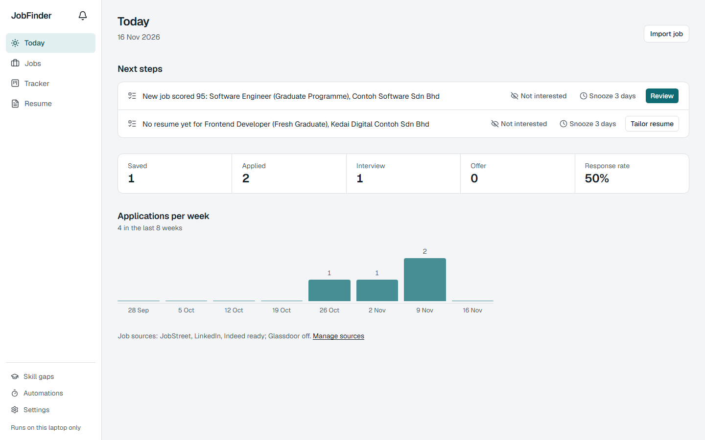
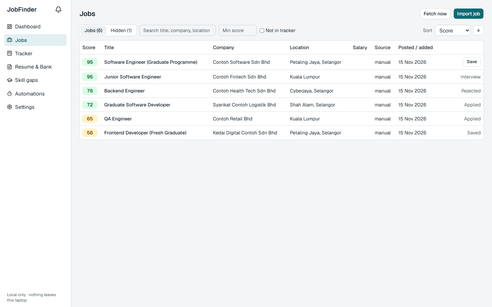
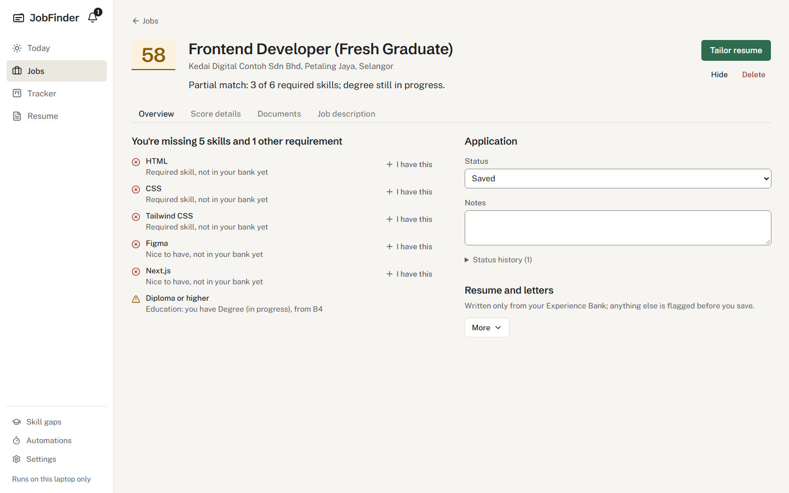
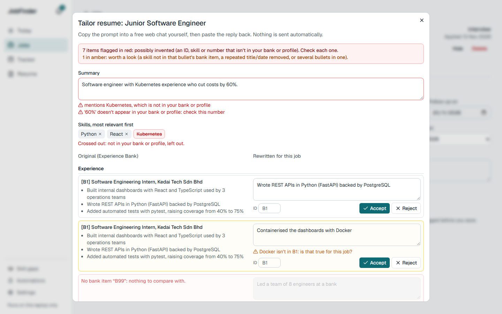
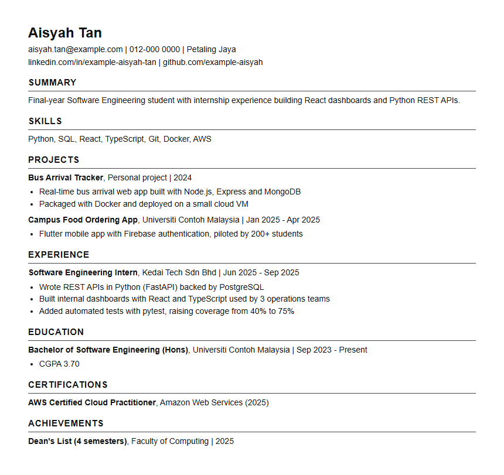
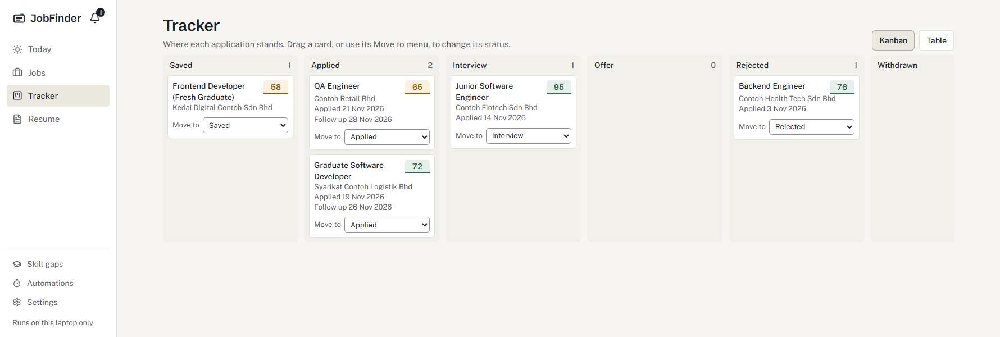
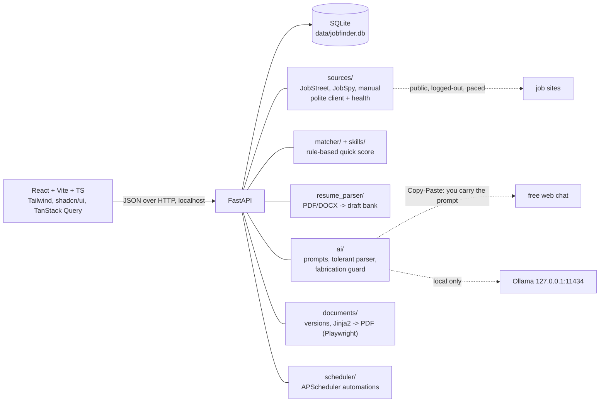

# JobFinder

**A local-only job search assistant for a fresh graduate:** it fetches Malaysian job ads politely, scores each one against your own experience with a score you can explain line by line, tracks your applications, and tailors resumes and cover letters with AI **without letting the AI invent anything**.

It runs entirely on one Windows laptop. There are no accounts, no paid APIs, and no logging in to job sites. Your data stays in a local SQLite file.


> All screenshots and examples use **fake demo data** (`scripts/seed_demo.py`).



## Why I built it

Job hunting as a fresh graduate means reading dozens of ads a week that are really for seniors, rewriting the same resume for each one, and losing track of where you applied. Generic AI resume tools also have a habit of making things up: a skill you never used, a "40% improvement" that never happened.

JobFinder does the reading and bookkeeping, and treats **accuracy as the first rule**:
- every score is explainable;
- every AI-written bullet must point at a real item in your Experience Bank;
- anything that doesn't is flagged before it can reach a PDF.

## Key features

| | |
|---|---|
| **Explainable quick score (0–100)** | Rule-based and offline. Required skills 45, preferred 15, years 20, education 10, language + location 10. Each line is ✅ met / ⚠️ partial / ❌ not met / ➖ not specified, with the bank item that proves it. Hard gates cap a job at 40 (e.g. far more years required than you have). Thin or summary-only ads are marked "low confidence" instead of scoring high. |
| **Experience Bank** | Upload a PDF/DOCX resume. It's parsed into a reviewable draft, and each item gets a stable ID (`B1`, `B2`, …). The bank, not the original PDF, is the source of truth. |
| **Polite job fetching** | JobStreet (its public, logged-out search API) and LinkedIn / Indeed / Glassdoor via `python-jobspy`. Requests go one at a time, 2–6 s apart, capped per run and per day. A 403/429 pauses that source for 24 h and notifies you. There are no credential fields anywhere. Manual import (paste a JD or URL) always works. |
| **Dedupe and filters** | The same job from several sites becomes one job with several links. Filter rules (Senior/Lead titles, years, companies, salary, a title allow-list) hide noise, and every hidden job shows why. |
| **AI without paid APIs** | **Copy-Paste** mode builds the full prompt for a free web chat and checks the pasted reply. **Ollama** runs a small local model (3B, fits a 3 GB GPU). **Off** keeps everything else working. |
| **Fabrication guard** | See below. Flags are red (possibly invented) or amber (worth a look), right next to the item, in a side-by-side review. |
| **Documents** | Numbered resume / cover-letter / analysis versions per job. An ATS-friendly single-column PDF via headless Chromium (selectable text, standard headings, clickable profile links). The tracker records which version you actually sent. |
| **Tracker** | Kanban (drag and drop) and table views, status history, follow-up reminders. |
| **Today** | Opens on what to do next, built from real state: new high matches, follow-ups due, resumes ready to send, profile gaps. A first-run checklist (profile, resume, first job) until there is something to show. Each job page has one primary button that follows the job: Save to tracker, Tailor resume, Download resume, Mark as applied. |
| **Automations** | Daily fetch, scoring, high-match alerts and follow-up reminders (APScheduler, with catch-up after the laptop was off), each with a run log. |
| **Skill gaps** | The skills your saved jobs ask for that you don't have yet, ranked by how often they're asked for. |

| Jobs list | Job detail: score, one-line verdict, the next step |
|---|---|
|  |  |

| AI review with fabrication flags | Resume PDF (preview) |
|---|---|
|  |  |



## How the fabrication guard works

Every prompt includes your bank items **with their IDs** and the rule *"use only these facts; every bullet must cite the ID it came from."* Models don't always obey, so the reply is checked in code (`backend/ai/guard.py`) before you see it:

- **Red (possibly invented):**
  - a bullet with no ID, or an ID that isn't in your bank (it **can't be saved** until fixed);
  - a skill that is nowhere in your bank or profile, whether in the skills list or named in the text (detected through the skill dictionary and its aliases);
  - a number, percentage or money amount ("40%", "500+", "3x", "RM 2k") that doesn't appear in the source item (for bullets) or anywhere in your bank (for summaries and cover letters);
  - a requirement marked "met" with no evidence ID.
- **Amber (check it):**
  - a skill you have, but not in *that* item ("Docker isn't in B1: is that true for this job?");
  - a repeated title/date that was stripped automatically;
  - several bullets merged into one (there's a one-click split).

Replies are parsed tolerantly: code fences, smart quotes, trailing commas and comments are handled. A schema error names the exact field, and a "fix-up prompt" asks the chat to correct itself. The guard never silently fixes content. It flags, and you accept, edit or reject each item. Only accepted items are saved.

**Limits:** numbers written as words ("five engineers") and invented achievements that name no skill or number can't be detected automatically. That's what the side-by-side review is for.

## How polite scraping works

- **Logged out only.** The app never asks for or stores a job-site password.
- **One request at a time** per source, a random 2–6 s apart, with an honest user agent and per-run and per-day caps (default limit 5 per run from the UI).
- **Never fetch twice:** known jobs are never requested again.
- **Back off on the first sign of trouble.** 403, 429, LinkedIn's 999, a login-wall redirect, JobSpy's throttling warnings, or 3 errors in a row pause that source for 24 h. A notification tells you why, and the response is saved locally for diagnosis.
- **A refusal is respected:** e.g. JobStreet job pages that answered 403 are never retried. Their search summary is kept, marked "rough score", and you can paste the full ad yourself.

## Architecture



Data flow: fetch → normalise → dedupe → filter → save the full ad → quick score → alert if high → you review → (optional) AI deep analysis / tailored resume / cover letter, each saved as a version → apply → tracker → follow-up reminder.

## Tech stack

- **Backend:** Python 3.12, FastAPI, SQLModel/SQLAlchemy, Pydantic v2, SQLite, APScheduler, httpx, python-jobspy, pdfplumber, python-docx, Jinja2, Playwright (headless Chromium for PDFs), openpyxl.
- **Frontend:** React, Vite, TypeScript, Tailwind CSS, shadcn/ui, TanStack Query, React Router, dnd-kit.
- **Tests:** pytest (**449 tests**) and Vitest (**46 tests**). An autouse fixture blocks every real HTTP request and the real JobSpy call, so the suite never touches a live site. PDF tests render real PDFs offline and read them back.
- **CI:** GitHub Actions on `ubuntu-latest`: backend ruff (lint), mypy (types) and pytest (with Playwright Chromium); frontend Vitest and production build.

## How it was built (with Claude Code)

I built this with [Claude Code](https://claude.com/claude-code) as the implementer and myself as product owner and reviewer:

1. **Spec first.** [`PROJECT_BRIEF.md`](PROJECT_BRIEF.md) fixes the principles (accurate > efficient > simple > free > private > account-safe), the stack, the data model and acceptance criteria for three phases.
2. **One phase at a time.** Phase 1 was the core (no scraping, no AI), Phase 2 sources and automations, Phase 3 AI and documents. Each ended with a report ([1](PHASE1_REPORT.md), [2](PHASE2_REPORT.md), [3](PHASE3_REPORT.md)) checked against the acceptance criteria.
3. **Reviews and real-use tests.** I ran supervised smoke tests against the real sites (with me present, small limits) and reviewed real outputs. Each round produced concrete fixes, e.g.:
   - JobSpy's silent LinkedIn throttling is now detected;
   - "Version control" no longer counts as Git;
   - numbers invented by the AI are now flagged;
   - headings no longer end a PDF page.
4. **Every judgment call is logged.** [`DECISIONS.md`](DECISIONS.md) has 180+ numbered decisions with their reasons.
5. **Standing rules** in [`CLAUDE.md`](CLAUDE.md): no live requests unless I start a supervised step, never touch the real database, no personal data in the repo, full test suite before every commit, ask before adding dependencies.

## Run it

Requirements: Windows 10/11, Python 3.11+ (tested 3.12), Node.js 20+ (tested 22).

1. **`setup.bat`** (once): creates `backend\.venv`, installs Python packages and Playwright's Chromium, and runs `npm install`.
2. **`start.bat`**: starts the API (http://127.0.0.1:8730) and the UI (http://localhost:5730) together in **one minimized window** and opens your browser. **`stop.bat`** stops both (closing that window works too). `start-debug.bat` starts them in two visible windows if you want to watch the logs. `create-shortcut.bat` (optional, once) puts a JobFinder shortcut on your Desktop.
   - The database is **backed up automatically** once a day when JobFinder starts (`data\backups\jobfinder-auto-*.db`, the last 14 kept). Settings → Export & backup shows the last backup.
3. **Try it with fake data:**
   ```bash
   backend\.venv\Scripts\python scripts\seed_demo.py
   ```
   This creates `demo_data\`. Run the backend with `JOBFINDER_DATA_DIR=demo_data`, `JOBFINDER_FAKE_SOURCES=1` and `JOBFINDER_NO_SCHEDULER=1`. `scripts\screenshots.py` does all of this on spare ports and regenerates the screenshots, fully offline.

Daily use: upload your resume (**Resume & Bank**), fill in **Settings → Profile**, then **Jobs → Fetch now** or **Import job**. Step-by-step guides are in the phase reports.

**Tests:**
```bash
cd backend && .venv\Scripts\python -m pytest
```
```bash
cd frontend && npx vitest run && npm run build
```

## Limitations (honest list)

- **Windows-first.** `setup.bat`/`start.bat` are Windows scripts. The code and tests also run on Linux (CI), but there's no Linux/macOS launcher.
- **Scrapers are fragile by nature.** Sites change their endpoints. JobStreet job pages refused requests during testing, so JobStreet details come from its search API only, and some jobs stay "summary only" until you paste the full ad. Glassdoor coverage for Malaysia is thin.
- **Ollama hasn't been tested with a real model yet**, only against a mocked API. Small 3B models may miss JSON fields more often than web chats; the tolerant parser and fix-up prompt exist for that.
- **The quick score is rules, not understanding.** It depends on the skill dictionary and on how the ad is written. That's why it shows its working and marks thin ads as low confidence.
- **The fabrication guard can't catch everything** (see above). You still review each item.
- **Single user, single laptop**, by design. No accounts, no sync, no DOCX export, one resume layout.

## More

- [SECURITY.md](SECURITY.md): threat model, every control, and known limits.
- [LEARNING.md](LEARNING.md): how each part works, explained simply, with likely interview questions.
- [DECISIONS.md](DECISIONS.md): every design decision with its reason.

## License

[MIT](LICENSE)
